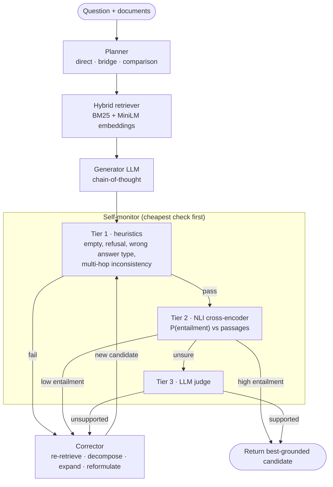

# Self-Healing Agentic RAG

[](https://github.com/kwazzy-coder/Self-Healing-Agentic-RAG-System/actions/workflows/ci.yml)


[](https://colab.research.google.com/github/kwazzy-coder/Self-Healing-Agentic-RAG-System/blob/master/notebooks/reproduce_results.ipynb)

A retrieval-augmented QA system that **checks its own answers for hallucinations and repairs them
before replying**, while keeping the extra LLM cost low.

Standard RAG answers confidently even when retrieval missed the evidence or a multi-hop chain
broke. This system:

1. runs a **three-tier monitor** on every answer: free heuristics → a 70M-parameter NLI model → an
   LLM judge, which is called *only* when the NLI model is unsure;
2. picks a **repair strategy from the type of failure**: targeted re-retrieval, question
   decomposition, context expansion or reformulation;
3. **re-verifies every repaired answer** and returns the best-grounded candidate, so a repair can
   never replace a better answer. If no candidate passes, the answer is returned marked `verified: false`.

It is evaluated on **HotpotQA** (multi-hop QA) and **RAGBench** (labelled hallucinations), with
ablations, paired significance tests and cost tracking. It also ships as a **FastAPI** service and a
**Gradio** demo.

---

## How it works



| Monitor tier | What it checks | Cost |
|---|---|---|
| 1. Heuristics | empty answer, "I don't know", yes/no question answered with an entity, final answer contradicting the last reasoning hop | ~0 ms, no model |
| 2. NLI | `nli-deberta-v3-small` scores whether the passages *entail* the answer (as a claim; long answers sentence by sentence) | ~50 ms on CPU, no API call |
| 3. LLM judge | full-context SUPPORTED / UNSUPPORTED verdict | 1 API call, only in the NLI's uncertain band |

| Failure | First repair | Idea |
|---|---|---|
| refusal | reformulate | rephrase, retrieve again |
| unsupported answer | targeted re-retrieval | the LLM writes a query for the *missing* evidence; passages already seen are excluded |
| hallucination (judge) | expand context | add passages about the question and the current answer's entity |
| wrong answer type | decompose | sub-questions; hop 2 gets hop 1's answer substituted for `#1` (Self-Ask style) |
| hop inconsistency | adopt last hop | use the verified last-hop answer (no LLM call) |

Strategies are never repeated, retrieval strategies are skipped when no unseen passages remain, and
the loop stops after 2 corrections (configurable). The details are in [docs/REPORT.md](docs/REPORT.md),
and the reasoning behind each choice is in [docs/DESIGN_DECISIONS.md](docs/DESIGN_DECISIONS.md).

---

## Quickstart

```bash
git clone https://github.com/kwazzy-coder/Self-Healing-Agentic-RAG-System.git
cd Self-Healing-Agentic-RAG-System
python -m venv .venv && source .venv/bin/activate      # Windows: .venv\Scripts\activate
pip install torch --index-url https://download.pytorch.org/whl/cpu   # optional: small CPU-only torch
pip install -r requirements.txt
cp .env.example .env        # add a free GROQ_API_KEY or GEMINI_API_KEY
python demo.py              # 5 questions, prints the self-healing trace
```

| | Command |
|---|---|
| Web UI (Gradio) | `python ui.py` → http://localhost:7860 |
| REST API | `uvicorn api.server:app` → http://localhost:8000/docs |
| Docker (API + UI) | `docker compose up --build` |
| Tests (offline, no key) | `pip install -r requirements-dev.txt && pytest` |

Providers: Groq, Gemini, OpenAI, Ollama (local) or Flan-T5 (local, no key). All of them go through
one OpenAI-compatible client, so switching is one line in `.env`. See [docs/BACKENDS.md](docs/BACKENDS.md).

### API example

```bash
curl -s localhost:8000/v1/ask -H 'Content-Type: application/json' -d '{
  "question": "What is the nationality of the director of Inception?",
  "documents": ["Title: Inception\nInception is a 2010 film directed by Christopher Nolan.",
                "Title: Christopher Nolan\nChristopher Nolan is a British-American filmmaker."]
}'
```

The response contains `answer`, `initial_answer`, `healed`, `verified`, every monitor/correction round
(`rounds`), the passages used (`sources`) and the cost (`n_llm_calls`, tokens, per-stage latency).
`POST /v1/verify` runs only the hallucination check on an answer you supply.

---

## Evaluation

| Experiment | Command | API key? |
|---|---|---|
| Retrieval: BM25 vs dense vs hybrid vs RRF | `python -m evaluation.benchmark_retrieval --n_samples 500` | no |
| Hallucination detection on RAGBench | `python run_evaluation.py --dataset ragbench --subset covidqa --mode detector --monitors heuristic,heuristic_nli,tiered,llm` | only for `tiered`/`llm` |
| QA: self-healing vs baselines on HotpotQA | `python run_evaluation.py --dataset hotpotqa --n_samples 100 --systems vanilla_rag,planner_only,self_healing,llm_judge_only,crag` | yes |
| 15 ablations (no NLI, no judge, rounds, top-k, fusion, closed-book…) | `python -m experiments.run_all_experiments` | yes |
| Error analysis + case studies | `python -m analysis.error_analysis results/<tag>/self_healing.jsonl` | no |

Each QA report includes EM/F1 with 95% bootstrap CIs, **McNemar / paired-bootstrap p-values** against
vanilla RAG, LLM calls and latency per question, which monitor tier made the decision, and a
**healing analysis**: how often the monitor flagged an answer that really was wrong, how many wrong
answers healing fixed, how many right answers it broke, and the accuracy of *verified* vs *unverified*
answers. Runs are checkpointed per question,
so a free-tier rate limit just means re-running the same command later.

The easiest way to reproduce everything is the
[Colab notebook](notebooks/reproduce_results.ipynb).

### Results

<!-- RESULTS:START -->
> Results have not been generated yet. Run the notebook (or the commands above), then
> `python -m analysis.update_readme results/<retrieval-dir> results/<detector-dir> results/<qa-dir>`
> to paste the generated tables here. This section only ever shows numbers produced by the scripts.
<!-- RESULTS:END -->

---

## Project structure

```
agent/
  llm_reasoner.py        provider-agnostic LLM client (retries, rate limits, token accounting)
  prompts.py             all prompt templates
  task_planner.py        strategy detection + LLM decomposition
  multihop.py            executes sub-questions with #1 substitution
  nli.py                 NLI cross-encoder wrapper (claims, premises, label mapping)
  self_monitor.py        3-tier failure detector
  corrective_actions.py  failure-type-driven repair strategies
  cost_tracker.py        per-query cost/latency (ContextVar, thread-safe)
retrieval/               hybrid BM25 + dense index (FAISS or NumPy), chunking, embedding cache
pipeline.py              orchestrator: plan → retrieve → generate → monitor ⇄ correct → select best
baselines/               vanilla, planner-only, NLI-only, LLM-judge-only, always-correct, CRAG
evaluation/              metrics, significance tests, evaluator (QA + detector), retrieval benchmark
experiments/             YAML ablation configs + runner
analysis/                markdown/LaTeX tables, plots, error analysis, README updater
api/server.py            FastAPI service
ui.py · demo.py          Gradio app · CLI demo
tests/                   98 offline tests (fake LLM / embedder / NLI) — run in CI on Python 3.10–3.12
notebooks/               Colab notebook that reproduces every result
docs/                    technical report, design decisions, provider setup
```

---

## Limitations

- Short answers are turned into a claim with a template before NLI; yes/no and numeric
  comparisons are hard for NLI and usually go to the LLM judge.
- The judge uses the same model as the generator, so it can share its blind spots.
- Thresholds (`NLI_LOW=0.2`, `NLI_HIGH=0.7`) were set by hand; they could be calibrated on RAGBench's train split.
- The benchmarks use per-question corpora (HotpotQA distractor). Open-corpus retrieval would need a persistent vector store.

## References

Lewis et al. 2020 (RAG) · Yang et al. 2018 (HotpotQA) · Trivedi et al. 2022 (MuSiQue) ·
Press et al. 2023 (Self-Ask) · Yao et al. 2023 (ReAct) · Shinn et al. 2023 (Reflexion) ·
Asai et al. 2024 (Self-RAG) · Yan et al. 2024 (CRAG) · Manakul et al. 2023 (SelfCheckGPT) ·
Friel et al. 2024 (RAGBench) · Cormack et al. 2009 (RRF). Full list: [docs/REPORT.md](docs/REPORT.md#references).
